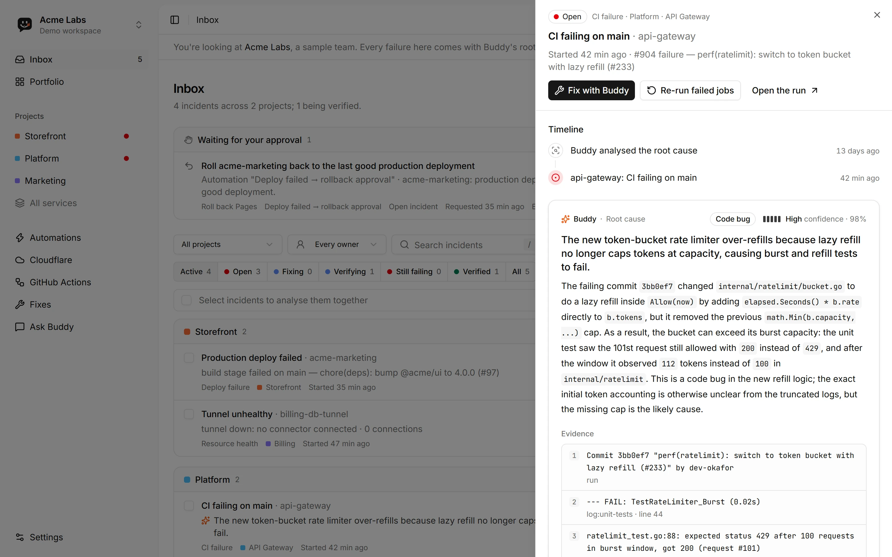
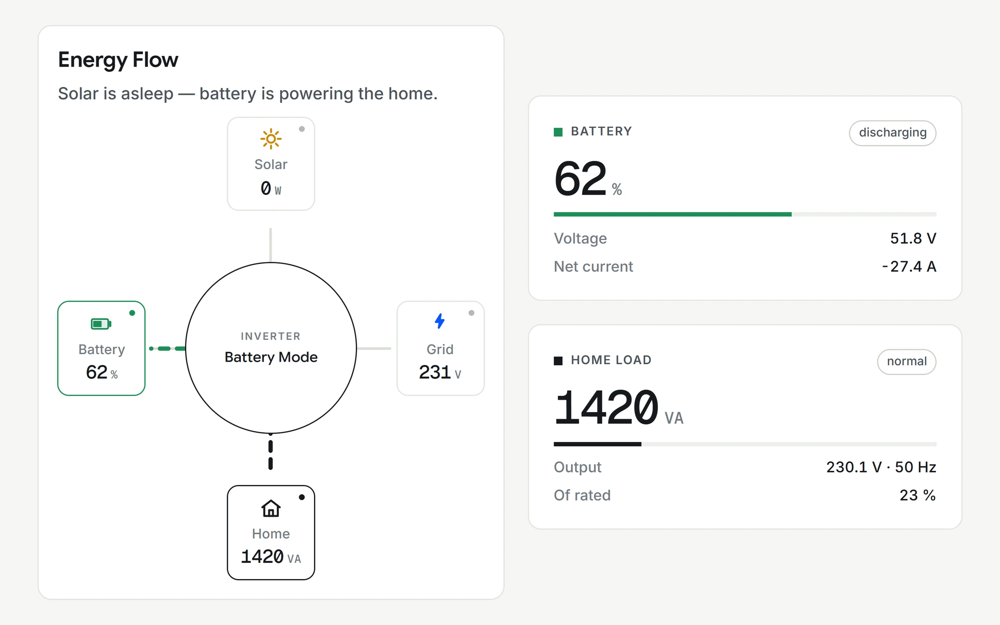

# Muhammad Ahmad

**Cloud | Cloud Security | Forward Deployed Engineer** · Lahore, Pakistan · open to remote roles

I build cloud systems, ship them with client teams and secure them.

- **Now:** Forward Deployed Engineer at iNNiData. I scope, build and ship supply-chain, logistics and navigation software with client teams, from system architecture and live demos to production.
- **Before:** DevOps and Cloud Engineer at TheDevswift. I migrated production workloads to AWS (ECS Fargate, RDS, Lambda) with Terraform, ran tenant provisioning for a multi-tenant SaaS on Azure AKS, and implemented SOC 2 Type II controls in CI/CD.
- **Education:** BS Computer Science, COMSATS University Islamabad (2022 to 2026).

  
  
  
  
  
  
  
  
  
  

## What I work on

| Area | Tools and practice |
|---|---|
| **Cloud** | AWS (ECS Fargate, Lambda, RDS, IAM), Azure (AKS, Cosmos DB), Cloudflare Workers, Terraform, Kubernetes, Docker, GitHub Actions |
| **Cloud security and DevSecOps** | SOC 2 Type II controls, dependency, image and IaC scanning, signed artifacts, least-privilege IAM, OIDC, secrets management |
| **Network and endpoint security** | Host firewalls (Windows Filtering Platform, iptables, eBPF), DNS filtering, packet capture, threat-intel blocking |
| **Forward deployed work** | Client scoping, solution architecture, live demos, change requests, shipping to production |
| **Monitoring** | Application Insights (KQL), CloudWatch, Prometheus, Grafana |

## Featured: DevOps Buddy

**Watches everything, touches nothing.** A DevOps co-pilot for GitHub Actions and Cloudflare. It follows pipelines, Workers, Pages, DNS and D1, explains why a run failed with the evidence behind it, and answers plain-English questions through an AI that can only call read-only APIs.

- **Read-only by default:** every upstream call goes through one guard that allows only reads.
- **Human-approved fixes:** the single write path needs a one-time approval, writes only to its own `buddy/*` branches, never merges or deletes, and is audit-logged.
- **Secrets stay server-side,** encrypted with AES-256-GCM.
- **Stack:** Cloudflare Workers (Hono), D1, React, Better Auth, OpenAI.

Root-cause analysis of a failed CI run, in a demo workspace with sample data. The code is private; a walkthrough is available on request.

## Solar Atlas

A solar monitoring dashboard built for one home and engineered as a reference multi-environment AWS platform. The web app shows live energy flow from the inverter; a Python backend on ECS and a collector Lambda store the readings in DynamoDB.

- **Infrastructure as code:** 30+ hand-built resources brought into Terraform, split into 7 modules with shared, dev and prod stacks.
- **Delivery:** GitHub Actions with OIDC (short-lived credentials). Every pull request runs a plan with tflint, Trivy, Checkov and gitleaks; merges apply to dev, prod is promoted by hand, and a nightly job checks for drift.
- **Edge and secrets:** CloudFront in front of a private S3 bucket (OAC); secrets in SSM Parameter Store.

## More projects

| Project | What it is |
|---|---|
| GateKeeper (final year project) | Endpoint security suite for Windows and Linux: DNS sinkhole, IP/port firewall with threat-intel feeds, per-app firewall, packet-capture monitor and a LangGraph assistant. Public modules: [DNS-Proxy-Sinkhole](https://github.com/Legend0300/DNS-Proxy-Sinkhole), [IP-Manager-Full](https://github.com/Legend0300/IP-Manager-Full), [ip-monitor](https://github.com/Legend0300/ip-monitor) |
| [Go Microservice Pipeline](https://github.com/Ahmed-Mansur/Go-Microservice-Pipeline) | Go auth and chat services with JWT, deployed to Azure AKS with Terraform, GitHub Actions CI/CD and Azure Monitor |
| [Passive-Recon-Tool](https://github.com/Legend0300/Passive-Recon-Tool) | Passive reconnaissance framework: modular engine, FastAPI web UI, CLI and structured reports |
| [AI-IDS](https://github.com/Legend0300/AI-IDS) | Network intrusion detection dashboard with a Random Forest model trained on NSL-KDD |

## Certifications

- **TryHackMe DevSecOps** learning path, Jan 2026 · [verify](https://tryhackme.com/certificate/THM-GJ5UFAZQLB)
- **TryHackMe Web Fundamentals** learning path (web application penetration testing), Oct 2025 · [verify](https://tryhackme.com/certificate/THM-MXIUGOWXNX)

## Contact

[LinkedIn](https://www.linkedin.com/in/muhammad-ahmad-b55539250/) · ahmed.mansur.bhatti@gmail.com
